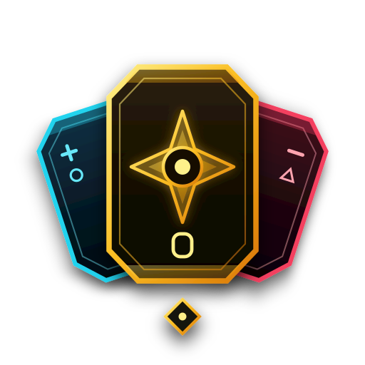

<div align="center">



# Corellian Spike Sabacc

**Self-hosted Star Wars card game for desktop, mobile PWA, and Android — with solo campaigns, daily seeded runs, persistent bankroll analytics, Discord table alerts, and OIDC SSO.**

[](https://github.com/thenotoriousJeremy/sabacc/releases)
[](https://github.com/users/thenotoriousJeremy/packages/container/package/sabacc)
[](https://github.com/users/thenotoriousJeremy/packages/container/package/sabacc)
[](https://github.com/thenotoriousJeremy/sabacc/actions)
[](LICENSE)

</div>


---

## Highlights

- **Four Game Modes + Interactive Tutorial**
  - **Play Sabacc**: Instant 1-tap solo table staking your persistent Vault bankroll against Star Wars cantina personas (*Novice*, *Regular*, and exact-enumerating *Shark* solvers).
  - **Cantina Tour**: 5-planet roguelite gauntlet (*Mos Eisley → Coronet → Fort Ypso → Cloud City → Canto Bight*) that unlocks table felts, card backs, and Spike Dice finishes.
  - **Daily Kessel Run**: Deterministic UTC-seeded 5-hand sprint (`250 CR`) where everyone plays the exact same shoe, with server daily rankings and 1-click Discord sharing.
  - **Friends (Multiplayer)**: 5-character room codes, `?room=CODE` deep links, scannable **LAN QR invites**, and a real-time **Tables Live** radar on the home screen.
  - **30-Second Interactive Tutorial**: Hands-on 4-step walkthrough where new players practice swapping cards to hit `0` and test the Spike Dice before dealing in.
- **Persistent Credits Over Time & Daily Progression**
  - **Smuggler Vault & Equity Chart**: Credits carry across sessions with a scrubbable **120-hand Credits Over Time** chart (toggle between *Vault Balance* and *Honest Career Net P&L*, unaffected by free stipends or bailouts) and a **30-day session ledger**.
  - **Daily Hooks**: Escalating **Daily Login Bonuses** (`+150` to `+500 CR`), **3 UTC-seeded Daily Bounties** (`+400 CR` sweep bonus), **8 Reputation Ranks**, and automatic **Cantina Bailouts** (`300 CR`) if you bust out.
  - **Server-Wide Standings (`/data/pilots.json`)**: Self-hosted servers persist every human player's all-time net credits, win rate, trend sparkline, and daily Kessel Run scores.
- **Crafted for Mobile & Desktop**
  - Full-bleed recessed holotable, right-handed thumb-zone button layout, zero finicky mobile sliders, synthesized WebAudio + haptics, **Corellian Dark Holotable** & **Beskar Titanium Light Mode**, 6 table felts, and 5 deck backs.
  - Runs as a standalone **iOS / Android PWA** or **Android APK** (`sabacc-android.apk`) with an **offline on-device engine** for all solo modes.
- **Built for Self-Hosters**
  - Multi-arch rootless-ready Docker image (`linux/amd64`, `linux/arm64`) with `tini`, `PUID`/`PGID`, `/healthz` & `/readyz` probes, **Discord webhooks**, **Site Password lock**, **OpenID Connect (OIDC + PKCE)**, and an in-app **Admin Console** (`/data/config.json`).

---

## Quick Start

### Option 1: Docker Compose (Recommended)

```yaml
services:
  sabacc:
    image: ghcr.io/thenotoriousjeremy/sabacc:latest
    container_name: sabacc
    restart: unless-stopped
    ports:
      - "3000:3000"
    volumes:
      - ./data:/data
    environment:
      TZ: America/New_York
      PUID: 1000
      PGID: 1000
      # Optional — reverse proxy, passwords, and Discord alerts:
      # TRUST_PROXY: "true"
      # PUBLIC_URL: https://sabacc.yourdomain.com
      # SESSION_SECRET: replace-with-32-char-random-secret
      # ADMIN_PASSWORD: your-admin-password
      # SITE_PASSWORD: optional-site-wide-password
      # DISCORD_WEBHOOK_URL: https://discord.com/api/webhooks/...
```

```bash
docker compose up -d
```

Open `http://localhost:3000` (or your reverse-proxied domain). Persistent admin settings (`config.json`) and server-wide player standings (`pilots.json`) are stored automatically in `./data`.

### Option 2: Single `docker run`

```bash
docker run -d \
  --name sabacc \
  -p 3000:3000 \
  -v "$(pwd)/data:/data" \
  -e ADMIN_PASSWORD="change-me" \
  ghcr.io/thenotoriousjeremy/sabacc:latest
```

### Option 3: Standalone Binary (No Docker or Node Required)

1. Grab `sabacc-host` for **Windows**, **macOS (Apple Silicon)**, or **Linux** from [Releases](https://github.com/thenotoriousJeremy/sabacc/releases).
2. Extract the archive (keep `sabacc-host` and `web/` in the same folder) and run `./sabacc-host`.
3. Open the printed LAN URL or scan the in-game **Invite QR** from any phone on your Wi-Fi.

### Option 4: Mobile (iOS PWA & Android APK)

- **iOS & Android PWA**: Visit your server URL in Safari (iOS) or Chrome (Android) and tap **Share → Add to Home Screen** for a full-screen standalone app.
- **Android APK**: Install `sabacc-android.apk` from [Releases](https://github.com/thenotoriousJeremy/sabacc/releases). Solo modes (*Play*, *Tour*, *Daily*) run **100% offline on-device**; tap **Friends** and enter a server URL to join multiplayer tables.

---

## Admin Console, Passwords, Discord & OIDC

### Live Admin Console
Click the **Shield** icon in the top-right corner of the home screen (or **Menu → Admin** at a table) and unlock with `ADMIN_PASSWORD`. From the UI you can:
- Set or remove a **site-wide password** without restarting the container
- Configure & **Test Ping** your **Discord Webhook**
- Post a custom **server announcement banner** on the home screen
- Toggle public lobby table discovery or lock starting bankrolls globally
- Inspect active multiplayer rooms and close stale tables

### Discord Webhook Deep-Linking
Set `DISCORD_WEBHOOK_URL` via environment variable or inside the **Admin Console**. Every Discord embed includes a clickable URL (`PUBLIC_URL`, or auto-detected from your server's `Origin` / `X-Forwarded-Host` headers):
- **Public Table Opened**: Posts host name, stakes, and a **`👉 Join Table CODE Now`** link (`https://your-domain/?room=CODE`) that drops friends directly into that room.
- **Sabacc Pot Jackpots & Tour Victories**: Announces Specialty Sabacc pot sweeps (`>= 25 CR`) and 5-planet Cantina Tour clears with a link to the holotable.
- **Daily Kessel Run Shares**: Adds a 1-click **Post to Discord** button on the Daily Run summary screen.

### OpenID Connect (OIDC) Single Sign-On
Works out-of-the-box with **Authentik, Authelia, Keycloak, Pocket ID, Zitadel, Kanidm, Okta**, and any standard OIDC provider using Authorization Code + PKCE (`S256`).

Register `${PUBLIC_URL}/api/auth/oidc/callback` as an allowed redirect URI in your provider:

```env
PUBLIC_URL=https://sabacc.yourdomain.com
TRUST_PROXY=true
SESSION_SECRET=replace-with-random-32-char-secret
OIDC_ISSUER_URL=https://auth.yourdomain.com/application/o/sabacc/
OIDC_CLIENT_ID=sabacc
OIDC_CLIENT_SECRET=your-client-secret
OIDC_PROVIDER_NAME=Authentik
OIDC_REQUIRE_AUTH=true
OIDC_ALLOWED_GROUP=sabacc-players
OIDC_ADMIN_GROUP=sabacc-admins
OIDC_ADMIN_EMAILS=you@yourdomain.com
```

### Reverse Proxy Notes
- Set `TRUST_PROXY=true` behind **Caddy**, **Traefik**, **Nginx / Nginx Proxy Manager**, or **Cloudflare Tunnel**.
- Ensure **WebSocket support** is enabled on your proxy (enabled automatically in Caddy, Traefik, and Cloudflare; toggle *Websockets Support* on in Nginx Proxy Manager).
- Same-host origins and `PUBLIC_URL` are permitted automatically — `ALLOWED_ORIGINS` is only needed if hosting the web frontend on a separate domain from the Socket.IO server.

---

## Environment Variables Reference

See [`.env.example`](.env.example) for a copy-paste template.

| Variable | Default | Description |
| :--- | :--- | :--- |
| `PORT` | `3000` | HTTP & Socket.IO listen port inside the container. |
| `CONFIG_DIR` | `/data` (`./data` local) | Directory persisting `config.json` (admin settings) and `pilots.json` (standings). |
| `PUID` / `PGID` | `1000` / `1000` | User/group IDs owning `/data` when started as root. |
| `TZ` | `Etc/UTC` | Container timezone. |
| `TRUST_PROXY` | `false` | Trust `X-Forwarded-For` / `X-Forwarded-Proto` / `X-Forwarded-Host` headers. |
| `PUBLIC_URL` | *(auto-detected)* | Canonical external URL for Discord `/?room=CODE` join links and OIDC redirects. |
| `ALLOWED_ORIGINS` | *(same-host + LAN)* | Optional comma-separated Socket.IO CORS allowlist for split-domain setups. |
| `SESSION_SECRET` | *(ephemeral random)* | HMAC secret signing `HttpOnly` auth cookies (set a fixed string in production). |
| `SITE_PASSWORD` | *(unset)* | Password-locks both the web UI and all Socket.IO connections. |
| `ADMIN_PASSWORD` | *(unset)* | Unlocks the Admin Console (can also be bootstrapped on `localhost` first run). |
| `DISCORD_WEBHOOK_URL` | *(unset)* | Discord webhook (`https://discord.com/api/webhooks/...`). |
| `DISCORD_NOTIFY_ROOMS` | `true` | Post to Discord when a public multiplayer table opens. |
| `DISCORD_NOTIFY_JACKPOTS` | `true` | Post to Discord on `25+ CR` Sabacc Pot sweeps and Cantina Tour wins. |
| `DISCORD_ALLOW_SHARE` | `true` | Allow players to share Daily Kessel Run scorecards to Discord. |
| `DEFAULT_STAKES` | `medium` | Default table stakes (`low`, `medium`, `high`, `no_limit`). |
| `PUBLIC_LOBBY` | `true` | Show open public multiplayer rooms on the home screen radar. |
| `LOCK_CREDITS` | `false` | Disallow mid-session chip top-ups across multiplayer tables. |
| `SERVER_NOTICE` | *(empty)* | Banner text displayed under the title on the home screen. |

**Health Endpoints**: `GET /healthz` (`{ ok: true, rooms, uptime }`) • `GET /readyz` (`{ ready: true }`)

---

## Corellian Spike Rules & 13-Hand Hierarchy

- **62-Card Deck**: **30 Positive** (`+1` to `+10` across Circle, Triangle, Square), **30 Negative** (`-1` to `-10` across Circle, Triangle, Square), and **2 Sylops** (`0`).
- **3 Rounds per Hand**:
  1. **Card Phase**: **Draw** a card, **Stand**, or **Swap** one card in hand with either the **Deck** or face-up **Discard**.
  2. **Betting Phase**: **Check**, **Bet**, **Call**, **Raise**, or **Fold** (with automatic **Side Pots** on short all-ins/table caps).
  3. **Spike Dice Check**: Two 6-sided Spike Dice roll at the end of every round — **Doubles** (`1-in-6`) trigger a **Sabacc Shift**, discarding every active hand and dealing the same number of replacement cards.
- **Two Pots**: The **Hand Pot** is won every hand by the best surviving hand; the **Sabacc Pot** rolls over until won at Showdown by a Specialty Sabacc (**Sabacc Pair** or higher).

| Rank | Hand | Requirement | Example | Claims Sabacc Pot |
| :---: | :--- | :--- | :--- | :---: |
| **1** | **Pure Sabacc** | Two Sylops (`0 + 0`) | `0, 0` | Yes |
| **2** | **Full Sabacc** | Sylop + four `10`s summing to `0` | `0, +10, +10, -10, -10` | Yes |
| **3** | **Fleet** | Sylop + four of a kind summing to `0` | `0, +5, +5, -5, -5` | Yes |
| **4** | **Yee-Haa** | Sylop + pair summing to `0` | `0, +4, -4` | Yes |
| **5** | **Rhylet** | Three of a kind + pair summing to `0` | `+2, +2, +2, -3, -3` | Yes |
| **6** | **Squadron** | Four of a kind summing to `0` | `+6, +6, -6, -6` | Yes |
| **7** | **Gee Whiz** | `1, 2, 3, 4` + `-10` (or `-1,-2,-3,-4` + `+10`) | `+1, +2, +3, +4, -10` | Yes |
| **8** | **Straight Khyron** | Run of 4 sequential values summing to `0` | `+7, -8, -9, +10` | Yes |
| **9** | **Banthas Wild** | Three of a kind summing to `0` | `+4, +4, +4, -3, -9` | Yes |
| **10** | **Rule of Two** | Two pairs summing to `0` | `+9, -9, +4, -4` | Yes |
| **11** | **Sabacc (Pair)** | Single pair summing to `0` | `+5, -5` | Yes |
| **12** | **Sabacc** | Unpaired hand summing to `0` | `+7, -3, -4` | *Carries over* |
| **13** | **Nulrhek** | Non-zero total (closest to `0` wins) | `+6, -5` (`+1`) | *Carries over* |

**Tie-Breakers**: Specialty ties go to the **lowest integer** (`+1/-1` beats `+9/-9`). Nulrhek ties go to **closest to `0`**, then **positive beats negative** (`+2` beats `-2`), **most cards**, **highest positive sum**, **highest single positive card**, and **suit** (**Circle > Triangle > Square**). Exact ties split the pot (or run a host-toggled **Single Blind Draw**).

---

## Privacy, Safety & Fair Play

- **Play-Only Virtual Credits**: `CR` are free entertainment-only scorekeeping points with zero real-world monetary value, wagers, cash-outs, or paid chip purchases.
- **Zero Trackers & Instant Data Erasure**: No third-party analytics or ad SDKs. Players can view `/privacy` anytime and wipe both local storage and server leaderboard records in one tap via **Profile → Data & Reset → Erase My Data**.
- **Multiplayer Moderation**: Server-side callsign and chat filtering, global **Chat On/Off** toggle, and per-seat **Mute** & **Report** controls.

---

## Local Development

Requires **Node.js 20.9+** (Node 22 LTS recommended).

```bash
npm ci
npm run dev          # Start Express + Socket.IO + Next.js on http://localhost:3000
npm run typecheck    # TypeScript strict check (tsc --noEmit)
npm run lint         # ESLint + React Compiler checks
npm test             # Run all 26 engine, solver, auth, progression & moderation tests
npm run showcase     # Capture real @3x headless Chrome 3-phone showcase PNG
npm run build:host   # Build single-executable host binary into dist/
npm run build:apk    # Build standalone offline/multiplayer Android APK via Capacitor
```

## License

MIT — see [LICENSE](LICENSE). Unofficial open-source fan project inspired by Star Wars™ lore.
