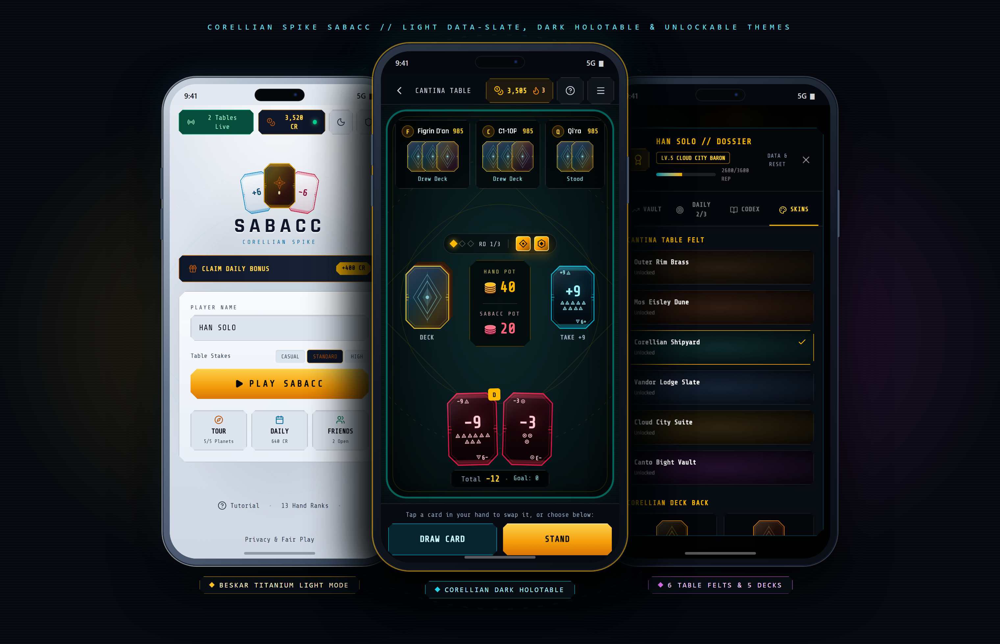

# Corellian Spike Sabacc

[](https://github.com/thenotoriousjeremy/sabacc/pkgs/container/sabacc)
[](https://github.com/thenotoriousjeremy/sabacc/pkgs/container/sabacc)
[](https://opensource.org/licenses/MIT)
[](https://github.com/thenotoriousjeremy/sabacc/actions)



A self-hosted Star Wars **Corellian Spike Sabacc** holotable featuring a persistent **Smuggler Vault & Credits-Over-Time Equity Chart**, **Daily Syndicate Bounties & Login Streaks**, a 5-planet roguelite **Cantina Tour**, deterministic **Daily Kessel Runs**, and real-time multiplayer cantina nights — with **Dark & Light sci-fi themes**, **server-wide leaderboards**, **Discord webhooks**, **site password / OIDC SSO**, and **offline mobile support**.

---

## Key Features

- **Persistent Credits Over Time & Progression**:
  - **Smuggler Vault & Equity Chart**: Credits carry across Quick Play sessions with a rolling **120-hand Credits Over Time chart** (toggle between *Vault Balance* and *Honest Career Net P&L*, unaffected by free stipends or Hutt bailouts) plus a **30-day session calendar**.
  - **Server-Wide Cantina Standings (`/data/pilots.json`)**: Self-hosted servers automatically persist every human pilot's all-time net credits, win rate, equity sparkline, and **Today's Kessel Run leaderboard**.
  - **Daily Syndicate Bounties & Login Streaks**: 3 deterministic UTC-seeded contracts every day (`+400 CR` Full Sweep bonus), escalating **Daily HoloNet Login Stipends** (`+150` to `+500 CR`), and **8 Reputation Ranks** (*Docking Bay Novice* → *Sabacc Grandmaster*).
- **4 Game Modes**:
  - **Quick Play**: 1-click table staking your persistent Vault against Star Wars cantina personas (*Novice*, *Regular*, and exact-enumerating *Shark* solvers) with live **Zero-Lock card-counting outs** on your turn.
  - **Outer Rim Cantina Tour**: 5-stage locked-bankroll gauntlet (*Mos Eisley → Coronet → Fort Ypso → Cloud City → Canto Bight*) that unlocks table felts, Beskar/Halcyon card backs, and Spike Dice finishes.
  - **Daily Kessel Run**: Deterministic UTC-seeded 5-hand sprint (`250 CR`) with server daily rankings and 1-click Discord score sharing.
  - **Multiplayer Party**: 5-character sector codes, `?room=CODE` deep links, scannable **LAN QR Invite**, and a real-time **Active Server Tables** radar so everyone on your server sees when a game is open.
- **Mobile, PWA & Standalone Android App**:
  - Edge-to-edge touch UI with notch/home-bar safe areas, installable as a full-screen **iOS / Android PWA** (*Add to Home Screen*) or via the **Android APK** (`sabacc-android.apk`).
  - **Offline On-Device Engine**: Solo modes (*Quick*, *Tour*, *Daily*) run directly on-device via `LocalGameTransport` when offline or without a server; Multiplayer connects to any self-hosted server.
- **Dark Holotable & Light Rebel Data-Slate Themes**:
  - Toggle anytime (`☀` / `☾`) between **Outer Rim Dark Holotable** and high-contrast **Bespin / Rebel Ivory Data-Slate** light mode.
- **Self-Hosted Security, OIDC & Admin Console**:
  - **Password Gate (`SITE_PASSWORD`)**: Lock the entire web UI and Socket.IO server behind an access code.
  - **Native OIDC + PKCE**: Works out-of-the-box with **Authentik, Authelia, Keycloak, Pocket-ID**, etc., auto-filling player callsigns and mapping admin groups.
  - **Live Admin Console** (shield icon): Rotate site passwords, set server banners, manage active rooms, lock bankrolls globally, and configure/test Discord webhooks — persisted to `/data/config.json`.
- **Discord Webhook Integration**:
  - Automatically posts rich embeds when a multiplayer table opens (with a clickable `?room=CODE` join link!), when a Specialty Sabacc sweeps a big Sabacc Pot, or when players share Daily Kessel Run scores.

---

## Deployment

### Docker Compose (Recommended)

A ready-to-run [`compose.yaml`](compose.yaml) is included (`linux/amd64` and `linux/arm64` / Raspberry Pi / Apple Silicon supported):

```yaml
services:
  sabacc:
    image: ghcr.io/thenotoriousjeremy/sabacc:latest
    container_name: sabacc
    restart: unless-stopped
    ports:
      - "3000:3000"
    volumes:
      - ./data:/data
    environment:
      TZ: America/New_York
      PUID: 1000
      PGID: 1000
      # Optional:
      # PUBLIC_URL: https://sabacc.example.com
      # TRUST_PROXY: "true"
      # SITE_PASSWORD: your-cantina-password
      # ADMIN_PASSWORD: your-admin-password
      # SESSION_SECRET: replace-with-random-secret
      # DISCORD_WEBHOOK_URL: https://discord.com/api/webhooks/...
```

```bash
docker compose up -d
```

### Standalone Release Binary (No Node or Docker Required)

1. Download the `sabacc-host` archive for Windows, macOS, or Linux from [Releases](https://github.com/thenotoriousjeremy/sabacc/releases).
2. Unpack it (keeping `sabacc-host` and `web/` together) and run `./sabacc-host`.
3. Scan the in-game **QR Invite** from any phone on your Wi-Fi to sit straight at the table.

### Mobile Installation & App Store Readiness

- **iOS & Android (PWA)**: Open your hosted URL in Safari (iOS) or Chrome (Android) and tap **Share → Add to Home Screen** for a full-screen standalone app (`>=44×44px` touch targets, notch/home-bar safe areas, no rubber-band bounce).
- **Android APK / Capacitor**: Run `npm run build:apk` (or install `sabacc-android.apk`). Solo modes (*Play*, *Tour*, *Daily*) run **100% offline on-device**; *Friends* connects to any LAN or remote server.
- **App Store & Google Play Compliance Built-In**:
  - **Play-Only Credits Disclosure**: Explicit in-app (`Privacy & Fair Play`) and public `/privacy` disclosures confirming zero real-money wagering, cash-outs, or IAP chip sales (Apple Guideline 5.3.4 / Google Play Simulated Gambling).
  - **Privacy Policy & In-App Data Erasure**: Static `/privacy` policy URL plus 1-tap **Erase My Data** (`localStorage` + `POST /api/pilot/delete`) inside Profile & Privacy (Apple Guideline 5.1.1 / GDPR).
  - **Multiplayer UGC Safety**: Automated callsign/chat profanity filtering (`lib/moderation.ts`), global **Chat On/Off** toggle, and per-seat **Mute** & **Report** controls (Apple Guideline 1.2).

---

## Configuration & Environment Variables

See [`.env.example`](.env.example) for a complete template. Runtime changes made in the **Admin Console** (shield icon on the home screen) are saved to `/data/config.json`.

| Variable | Default | Description |
| :--- | :--- | :--- |
| `PORT` | `3000` | HTTP & Socket.IO port. |
| `CONFIG_DIR` | `/data` (`./data` local) | Persistent directory for `config.json` admin settings. |
| `PUID` / `PGID` | `1000` / `1000` | Container user/group IDs owning `/data` (LinuxServer-style). |
| `TZ` | `Etc/UTC` | Container timezone. |
| `TRUST_PROXY` | `false` | Set `true` behind Traefik, Caddy, Nginx, or Cloudflare Tunnel. |
| `PUBLIC_URL` | *(unset)* | External URL (e.g. `https://sabacc.example.com`) for Discord join links & OIDC callbacks. |
| `ALLOWED_ORIGINS` | *(LAN + same-origin)* | Comma-separated Socket.IO origin allowlist for cross-origin setups. |
| `SESSION_SECRET` | *(random on boot)* | Secret for signing `HttpOnly` auth cookies (set a fixed string in production). |
| `SITE_PASSWORD` | *(unset)* | Password-restricts the entire site and all WebSocket connections. |
| `ADMIN_PASSWORD` | *(unset)* | Unlocks the **Admin Console** (`⚙` shield button). On `localhost` first run, can also be bootstrapped in the UI. |
| `DISCORD_WEBHOOK_URL` | *(unset)* | Discord channel webhook (`https://discord.com/api/webhooks/...`) for table-open alerts, jackpots & score shares. |

### OpenID Connect (OIDC) Setup

Register `${PUBLIC_URL}/api/auth/oidc/callback` as an allowed redirect URI in Authentik, Authelia, Keycloak, or Pocket-ID:

| Variable | Description |
| :--- | :--- |
| `OIDC_ISSUER_URL` | Provider issuer URL (must serve `/.well-known/openid-configuration`). |
| `OIDC_CLIENT_ID` | OIDC client ID. |
| `OIDC_CLIENT_SECRET` | OIDC client secret (optional for public PKCE clients). |
| `OIDC_PROVIDER_NAME` | Button label shown on login (default `SSO`, e.g. `Authentik`). |
| `OIDC_REQUIRE_AUTH` | Set `true` to require SSO login before accessing the site. |
| `OIDC_ALLOWED_GROUP` | Optional group required in `groups` claim to enter. |
| `OIDC_ADMIN_GROUP` | Group name that automatically grants Server Admin access. |
| `OIDC_ADMIN_EMAILS` | Comma-separated emails that automatically receive Server Admin access. |

### Health Probes

- `GET /healthz` → `{ ok: true, rooms, uptime }`
- `GET /readyz` → `{ ready: true }`

---

## Corellian Spike Rules Summary

62-card deck: **30 Positive** (`+1..+10`), **30 Negative** (`-1..-10`), and **2 Sylops** (`0`) across **Circle > Triangle > Square**. Each hand runs **3 rounds** of **Card Phase** (*Draw*, *Swap Shoe*, *Swap Discard*, *Stand*) → **Betting Phase** (with automatic **Side Pots**) → **Spike Dice Check** (doubles trigger a **Sabacc Shift**, discarding and redealing all active hands).

### 13-Hand Hierarchy (Highest → Lowest)

1. **Pure Sabacc** (`0, 0`) — *claims Sabacc Pot*
2. **Full Sabacc** (`0, +10, +10, -10, -10`) — *claims Sabacc Pot*
3. **Fleet** (Sylop + four of a kind) — *claims Sabacc Pot*
4. **Yee-Haa** (Sylop + pair) — *claims Sabacc Pot*
5. **Rhylet** (Three of a kind + pair) — *claims Sabacc Pot*
6. **Squadron** (Four of a kind) — *claims Sabacc Pot*
7. **Gee Whiz** (`+1,+2,+3,+4,-10` or `-1,-2,-3,-4,+10`) — *claims Sabacc Pot*
8. **Straight Khyron** (Sequential run of 4 summing to `0`) — *claims Sabacc Pot*
9. **Banthas Wild** (Three of a kind summing to `0`) — *claims Sabacc Pot*
10. **Rule of Two** (Two pairs summing to `0`) — *claims Sabacc Pot*
11. **Sabacc (Pair)** (One pair summing to `0`) — *claims Sabacc Pot*
12. **Sabacc** (Non-paired hand summing to `0` — *Sabacc Pot carries over*)
13. **Nulrhek** (Non-zero total: closest to `0` wins, positive beats negative, then most cards, positive sum, highest positive card, and suit)

---

## Development

```bash
npm ci
npm run dev          # Express + Socket.IO + Next on http://localhost:3000
npm run typecheck    # tsc --noEmit
npm run lint         # eslint .
npm test             # 22 unit, solver, security, config & offline transport tests
npm run build:host   # Static export + single-executable host binary into dist/
npm run build:apk    # Static export + standalone/multiplayer Capacitor Android APK
```

## License

MIT — see [LICENSE](LICENSE).
