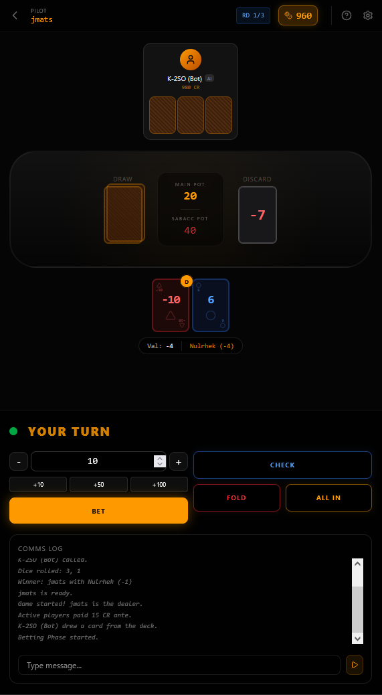

# Corellian Spike Sabacc

[](https://hub.docker.com/r/thenotoriousjeremy/sabacc)
[](https://github.com/thenotoriousjeremy/corellian-spike-sabacc/releases)

A multiplayer web-based version of the 'Corellian Spike' Sabacc game from Star Wars Legends. Experience the thrill of this classic card game with real-time multiplayer gameplay, featuring Sabacc Shifts, betting phases, and a Star Wars aesthetic.

## Features

- **Multiplayer Gameplay**: Real-time multiplayer using Socket.io for seamless interaction.
- **Authentic Deck**: 62-card deck with 30 positive, 30 negative cards, and 2 Sylops.
- **Game Phases**: Structured rounds with Card, Betting, and Dice phases.
- **Credit System**: Manage credits, antes, and pots with automatic balance updates.
- **Sabacc Shift**: Random Spike Dice rolls can trigger hand redeals for added excitement.
- **Star Wars Theme**: Dark UI with neon accents inspired by the Star Wars universe.
- **Cross-Platform**: Runs on any device with a modern web browser.

## Screenshots



## Installation

Corellian Spike Sabacc can be installed using Docker, Docker Compose, or manually. Docker is the recommended method for production deployments.

### Docker

To run the application using Docker:

1. Pull the latest image from GitHub Container Registry:
   ```bash
   docker pull ghcr.io/thenotoriousjeremy/sabacc:latest
   ```

2. Run the container:
   ```bash
   docker run -d \
     --name sabacc \
     -p 3000:3000 \
     -e NODE_ENV=production \
     -e TZ=Etc/UTC \
     ghcr.io/thenotoriousjeremy/sabacc:latest
   ```

The application will be available at `http://localhost:3000`.

### Docker Compose

For a more robust setup with automatic restarts and easier management, use Docker Compose. Create a `docker-compose.yml` file with the following content:

```yaml
version: '3.8'

services:
  sabacc:
    image: ghcr.io/thenotoriousjeremy/sabacc:latest
    container_name: sabacc
    ports:
      - "3000:3000"
    environment:
      - NODE_ENV=production
      - TZ=Etc/UTC
    restart: unless-stopped
```

Then run:

```bash
docker-compose up -d
```

To view logs:
```bash
docker-compose logs -f sabacc
```

To stop:
```bash
docker-compose down
```

### Manual Installation

If you prefer to run the application directly on your system:

1. **Prerequisites**:
   - Node.js 18+ and npm
   - Git

2. Clone the repository:
   ```bash
   git clone https://github.com/thenotoriousjeremy/corellian-spike-sabacc.git
   cd corellian-spike-sabacc
   ```

3. Install dependencies:
   ```bash
   npm install
   ```

4. For development:
   ```bash
   npm run dev
   ```

5. For production:
   ```bash
   npm run build
   npm start
   ```

The application will start on `http://localhost:3000`.

## Configuration

The application uses the following environment variables:

- `NODE_ENV`: Set to `production` for production builds
- `PORT`: Port to run the server on (default: 3000)
- `TZ`: Timezone (default: Etc/UTC)

## Usage

1. Open your web browser and navigate to `http://localhost:3000`.
2. Enter your player name and a room ID.
3. Set your starting credits.
4. Wait for other players to join and mark themselves as ready.
5. Play through the three phases of each round:
   - **Card Phase**: Draw, swap, or stand.
   - **Betting Phase**: Call, raise, or fold.
   - **Dice Phase**: Watch for the Sabacc Shift!

## Game Rules

This implementation follows the **Corellian Spike variant** of Sabacc.

### Winning the Game – Hand Hierarchy

Specialty hands – All hands must equal zero and lower integer wins a tie

- **Pure Sabacc** (2 Sylops)
- **Full Sabacc** (+10, +10, -10, -10, Sylop)
- **Fleet** (4 of a kind, Sylop): e.g. -5, -5, +5, +5, Sylop or -2, -2, +2, +2, Sylop.
- **Yee-Haa** (1 pair, Sylop ): e.g. +4, -4, Sylop or +2, +2, -4, Sylop.
- **Rhylet** (3 of a kind, 1 pair): e.g. +2, +2, +2, -3, -3 or +4, +4, +4, -6, -6.
- **Squadron** (4 of a kind): e.g. -6, -6, +6, +6 or -1, -1, +1, +1.
- **Gee Whiz** (+1, +2, +3, +4, -10 or -1, -2, -3, -4, +10)
- **Straight Khyron** (Run of 4 cards): e.g. +7, -8, -9, +10 or -2, +3, +4, -5.
- **Banthas Wild** (3 of a kind): e.g. +4, +4, +4, -3, -9 or +5, +5, -5, -3, -2.
- **Rule of Two** (2 pairs): e.g. -9, +9, -4, +4 or +3, +3, +5, -5, -6.
- **Sabacc** (1 pair): e.g. +5,-5 or +3, +3, -6.

Non-specialty hands that also equal zero

- **Most Cards**: The hand with the highest number of cards wins.
- **Highest Positive Sum**: Add all positive numbers in each hand, the hand with the highest sum wins.
- **Highest Single Positive Value**: The hand with the single highest positive card.

When hands do not equal zero (Nulrhek)

- **Closest to zero**: The hand closest to zero wins
- **Positive score**: Positive beats negative (+3 beats -3)
- **Most Cards**: The hand with the most cards wins
- **Highest Positive Sum**: Add all positive numbers in each hand, the hand with the highest sum wins.
- **Highest Single Positive Value**: The hand with the single highest positive card.

True Tie

- **Single Blind Draw**: If all of the above scenarios also end in a tie each remaining play draws 1 card. The player closest to zero wins the hand. Positive numbers always beat negative numbers. If players still tie, keep doing the blind draw until a winner is decided.
  - **Card Suit Ranking**: If you want to avoid the luck of the draw, you can alternatively look at the card suit of the single highest positive card. Circle > Triangle > Square

### Deck Composition
- 30 positive cards (values 1-15, 2 of each suit)
- 30 negative cards (values -1 to -15, 2 of each suit)
- 2 Sylops (value 0, rank trump all)
- **Total: 62 cards**

### Gameplay Phases
1. **Card Phase** - Players draw, swap, or stand to improve their hands
2. **Betting Phase** - Players bet credits based on hand strength
3. **Dice Phase** - The Spike Dice is rolled; if triggered, hands are redealt (Sabacc Shift)

### Antes & Pots
- **Hand Pot**: Ante 10 credits + all bets
- **Sabacc Pot**: Fixed 5 credits per player (side pot)
- **Sabacc Winner**: Gets the Sabacc Pot if they win

For more details, see [How to Play - Sabacc](https://hyperspaceprops.com/how-to-play-corellian-spike/).

## Contributing

Contributions are welcome! Please fork the repository and submit a pull request.

1. Fork the project
2. Create your feature branch (`git checkout -b feature/AmazingFeature`)
3. Commit your changes (`git commit -m 'Add some AmazingFeature'`)
4. Push to the branch (`git push origin feature/AmazingFeature`)
5. Open a Pull Request

## License

This project is licensed under the MIT License - see the [LICENSE](LICENSE) file for details.

## Support

If you have any questions or issues, please open an issue on GitHub.
